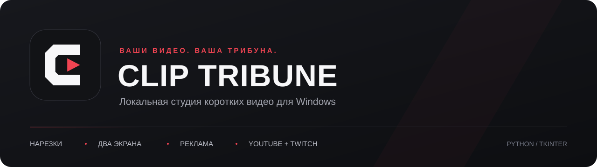

<p align="center"></p>

<p align="center">
  <a href="https://github.com/matthew-mbn/CLIP-TRIBUNE/releases/latest"><strong>Скачать для Windows</strong></a>
  · <a href="#первая-нарезка">Как пользоваться</a>
  · <a href="#запуск-из-python">Запуск из Python</a>
  · <a href="docs/learning-python.md">Изучение кода</a>
  · <a href="https://matthew-mbn.github.io/CLIP-TRIBUNE/">Сайт</a>
</p>

**CLIP TRIBUNE** — локальная студия коротких видео для Windows. Нарезки, запись прямых эфиров YouTube / Twitch, два экрана, реклама на зелёном фоне, скачивание видео и публикация в YouTube и TikTok.

Интерфейс написан на **Python + CustomTkinter**, с комментариями на русском. Монтаж выполняет FFmpeg на вашем компьютере. Для локального монтажа не нужны аккаунты, API-ключи или платная подписка.

## Установка готового приложения

**Новое в 0.5.0:** режим «Видео + вебка · 50/50» в «Эфирах» и «Студии».
Выделите камеру стримера мышкой: основное видео будет сверху, вебка — снизу.
[Настройка вебки](docs/webcam.md) · [Запись эфиров и отбор моментов](docs/live-streams.md).

1. Откройте [последний релиз](https://github.com/matthew-mbn/CLIP-TRIBUNE/releases/latest).
2. В **Assets** скачайте `CLIP-TRIBUNE-Windows-x64.zip`.
3. Распакуйте архив в удобную папку и запустите **CLIP TRIBUNE.exe**.
4. Пройдите короткую настройку. Для знакомства можно создать тестовую нарезку.

Проверенная система — **Windows 11 x64**. Python, Tkinter, FFmpeg, yt-dlp и Deno включены в EXE. Первый запуск может занять несколько секунд: программа распаковывает свои компоненты. Интернет нужен для скачивания видео и внешних интеграций.

EXE пока не подписан сертификатом издателя. Контрольная сумма находится в `SHA256SUMS.txt` рядом с архивом. Проверить скачанный файл можно командой:

```powershell
Get-FileHash ".\CLIP-TRIBUNE-Windows-x64.zip" -Algorithm SHA256
```

Для обновления закройте прежнее окно и запустите новый EXE. Настройки, подключения и библиотека сохраняются отдельно в `%LOCALAPPDATA%\CLIP TRIBUNE\storage`. Личные данные не входят в дистрибутив.

## Первая нарезка

1. **Источники → Добавить видео**: выберите MP4, MOV, MKV или WEBM и подтвердите права на материал.
2. Откройте **Студию** и выделите исходник. Ctrl + клик выбирает несколько.
3. Задайте число нарезок, длительность 15–60 секунд и разрешение 720 или 1080.
4. Нажмите **Создать нарезки**. Прогресс, отмена и повтор ошибок — в **Очереди**.
5. Откройте **Библиотеку**. **Смотреть** запускает проигрыватель Windows; **Сохранить как…** копирует MP4 в выбранную папку.

Выбор моментов основан на движении, сменах сцен и звуке. Программа показывает причины отбора, но не распознаёт смысл: результат нужно просмотреть. Если уникальных моментов мало, роликов получится меньше указанного количества.

## Два видео: верх и низ

1. Импортируйте оба видео в **Источники**.
2. В **Студии** выделите в таблице основной ролик — он будет **сверху**.
3. В поле **Экран** выберите **Два ролика: верх / низ**.
4. Выберите **Нижнее видео** и секунду его начала.
5. Включите повтор, если нижний материал короткий. Он повторяется с выбранной точки начала.
6. Выберите заполнение: **Обрезать по центру** или **Вписать целиком**.
7. Выберите звук: верхний ролик, нижний, оба или без звука.

Результат — вертикальное видео 9:16 с двумя равными половинами. По умолчанию слышен верхний ролик. Нижний исходник должен отличаться от верхнего и иметь подтверждённые права. Автоматический отбор моментов относится к верхнему видео; нижнее начинается с указанной секунды для каждой нарезки.

## Реклама на зелёном фоне

1. Откройте **Реклама → Загрузить вставку**: видео или PNG / JPG / WEBP.
2. Выберите **Один раз за ролик** и задайте секунду начала и длительность. `0` означает длину видео-вставки; для изображения — 5 секунд.
3. Либо выберите **Баннер на весь ролик**: вставка будет повторяться до конца видео.
4. Настройте положение, ширину и отступ. Цвет удаляемого фона по умолчанию — `#00FF00`.
5. Нажмите **Обновить предпросмотр**. Остался зелёный фон — увеличьте «Удаление фона». Исчезают детали — уменьшите. «Мягкость края» регулирует переход прозрачности.
6. Включите **Добавлять в новые нарезки** и нажмите **Сохранить настройки**.

В «Студии» рекламу можно отключить для конкретной серии. Настройки сохраняются в задании при постановке в очередь: последующие изменения не затрагивают уже созданные задания.

Для готового ролика: **Библиотека → Добавить рекламу → Создать копию с рекламой**. Оригинал сохранится. Вставка работает поверх двух экранов, накладывается без собственного звука и не удлиняет ролик. Длинная разовая вставка обрезается в конце ролика.

Предпросмотр проверяет фон и размещение на кадре 0,5 секунды вставки. Время показа проверяйте на готовом ролике. Материал рекламы ограничен 500 МБ и 10 минутами.

## Скачать YouTube или Twitch

В **Источниках** вставьте ссылку в блок **YouTube / Twitch**, выберите качество, подтвердите права на материал и нажмите **Скачать в источники**. Загрузка появится в очереди; её можно отменить. Готовый файл доступен для нарезки и обеих половин экрана.

Поддерживаются отдельные публичные видео и Shorts YouTube, записи трансляций и клипы Twitch. Каналы, плейлисты, действующие эфиры, закрытые и платные записи не загружаются. Ограничения: до 8 часов и 20 ГБ на исходник. Если сервис не предлагает 720p, попробуйте 1080p.

Загрузка использует [yt-dlp](https://github.com/yt-dlp/yt-dlp); ключ YouTube API для неё не нужен. Доступность зависит от сервиса, региона и версии загрузчика. Если сайт требует вход или ограничивает доступ, программа покажет ошибку. Cookies и пароли браузера автоматически не используются. Всегда остаётся импорт доступного вам локального файла.

## YouTube и TikTok

Локальный монтаж работает без этих подключений. Для публикации каждый пользователь настраивает свои разрешения и приложение разработчика.

**YouTube:**

1. Создайте проект в [Google Cloud Console](https://console.cloud.google.com/) и включите **YouTube Data API v3**.
2. Для «Трендов» создайте API key и ограничьте его API **YouTube Data API v3**.
3. Настройте OAuth consent screen. В режиме **Testing** добавьте свой Google-аккаунт в **Test users**.
4. Создайте **OAuth Client ID → Desktop app**. Внесите Client ID / Client Secret в **Настройки → Интеграции**.
5. Откройте **Публикация → Подключить канал** и завершите вход через Google.
6. Отправьте выбранный ролик. По умолчанию загрузка закрытая (`private`).

Ошибка `403 access_denied` в режиме Testing часто означает, что выбранный аккаунт отсутствует в Test users проекта OAuth-клиента. Проверка проекта и ограничения видимости управляются Google. Счётчик квот в приложении учитывает только его собственные запросы.

**TikTok:** поддерживаются отправка во входящие и Direct Post через официальный Content Posting API. Нужны приложение TikTok for Developers и разрешённые scopes. [Инструкция по настройке TikTok](docs/tiktok.md).

Ключи шифруются в локальной базе. Не публикуйте `storage`, `.env`, OAuth JSON и токены. Расходы внешних AI-провайдеров и условия платформ определяют соответствующие сервисы.

## Запуск из Python

Скачайте исходники через **Code → Download ZIP** и распакуйте в папку `CLIP TRIBUNE`, либо:

```powershell
git clone https://github.com/matthew-mbn/CLIP-TRIBUNE.git "CLIP TRIBUNE"
cd "CLIP TRIBUNE"
powershell -ExecutionPolicy Bypass -File .\setup_windows.ps1 -InstallTools
powershell -ExecutionPolicy Bypass -File .\start_windows.ps1
```

Установщик создаёт `.venv`, устанавливает зависимости из lock-файла, при необходимости скачивает Python 3.15 и FFmpeg в `.tools`. Администратор и Node.js не требуются. Затем достаточно `start_windows.ps1`.

Из Python используется `storage` внутри проекта — отдельная библиотека от EXE. Не переносите `.venv` между компьютерами: создавайте окружение через setup.

Сборка EXE:

```powershell
powershell -ExecutionPolicy Bypass -File .\build_windows.ps1
```

Результат: `dist\CLIP TRIBUNE.exe`. Иконка — `assets/app.ico`, логотип — `assets/logo.svg`, шапка — `assets/banner.svg`.

## Как устроен код

| Файл | Назначение |
|---|---|
| `launcher.py` | Окно, API, фоновые процессы |
| `desktop/app.py`, `desktop/theme.py` | Навигация, цвета и виджеты |
| `desktop/source_pages.py` | Источники, скачивание, студия |
| `desktop/ads_page.py` | Реклама и предпросмотр |
| `backend/schemas.py` | Проверка ввода |
| `backend/services.py` | Настройки заданий и очередь |
| `backend/composition.py` | Два экрана, хромакей, звук |
| `backend/video.py` | Анализ сцен и выполнение FFmpeg |
| `backend/ads.py`, `backend/ads_routes.py` | Импорт рекламы и копии роликов |
| `backend/downloads.py` | YouTube / Twitch и отмена загрузки |
| `backend/worker.py` | Обработка заданий |
| `backend/models.py`, `backend/migrations/` | Таблицы и обновления базы |
| `tests/` | Проверки API, интерфейса и видео |

Начните с [маршрута по Python-коду](docs/learning-python.md). Необязательные AI-интеграции: [речь и метаданные](docs/providers.md).

## Проверка и решение проблем

```powershell
.\.venv\Scripts\python.exe -m pytest -q
.\.venv\Scripts\python.exe -m ruff check backend desktop tests launcher.py scripts
```

Тесты используют отдельную базу и синтетические видео. Проверяют реальные пиксели хромакея, время показа, повтор нижнего ролика и частоты аудиодорожек. [Отчёт о проверке](docs/verification.md).

- **Порт 8765 занят:** закройте прежнее окно. Из исходников аварийная остановка: `powershell -ExecutionPolicy Bypass -File .\stop_windows.ps1`.
- **Нет субтитров:** подключите SpeechProvider. При его недоступности видео создаётся с сообщением об отсутствии субтитров.
- **Реклама начинается после конца:** уменьшите время начала или отключите рекламу для этой серии.
- **Нижний ролик короткий:** включите повтор либо выберите другой источник.
- **Сбой очереди:** прерванная задача станет ошибкой; нажмите «Повторить ошибки».
- **Мало места:** программа хранит копии исходников; нужен запас свободного диска.

Логи EXE: `%LOCALAPPDATA%\CLIP TRIBUNE\storage\logs`. Для резервной копии сохраните весь `storage`, включая `.encryption.key`; без ключа подключения не расшифровать.

## Ограничения

Нет полноценного монтажного timeline, трекинга лиц, гарантии смысловой завершённости или «вирусности» нарезки. Кодирование выполняется на CPU. Пресеты меняют параметры и эвристики; Storytelling / Educational / Custom пока используют общий алгоритм отбора. AI-озвучка и генерация видео по тексту не реализованы.

Социальные сети могут менять API и доступность загрузок. CLIP TRIBUNE не связан с Google, YouTube, Twitch или TikTok. [Компоненты и лицензии](docs/third-party-notices.txt).

[Условия использования](https://matthew-mbn.github.io/CLIP-TRIBUNE/terms-ru.html) · [Политика конфиденциальности](https://matthew-mbn.github.io/CLIP-TRIBUNE/privacy-ru.html).
